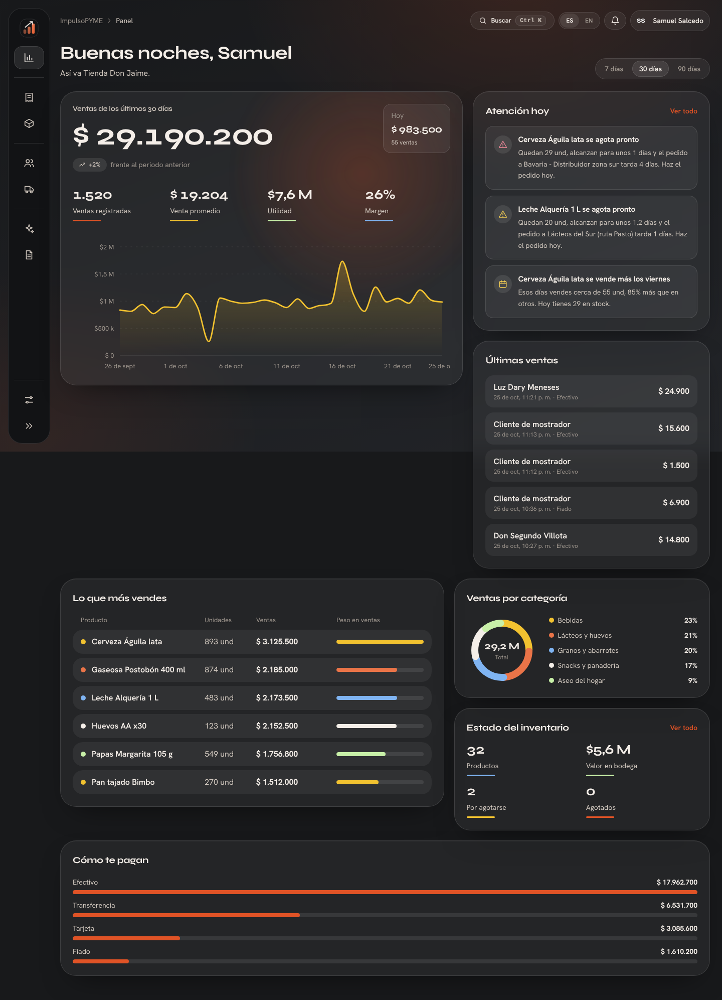
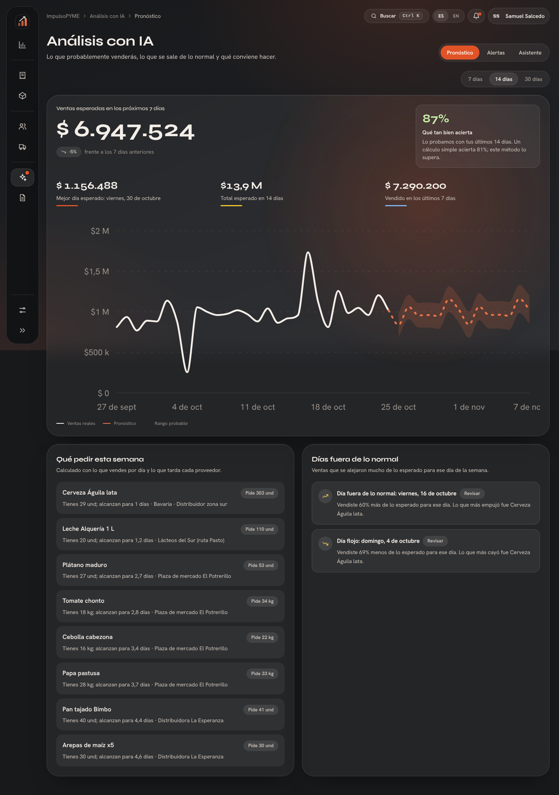
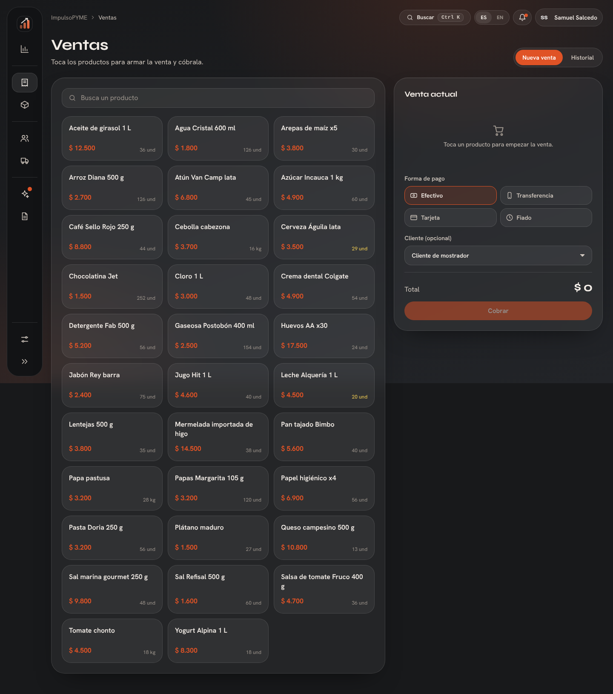
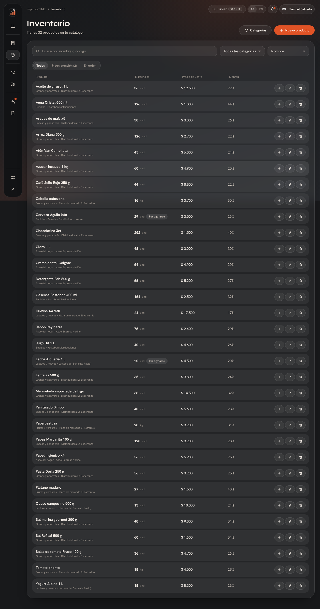
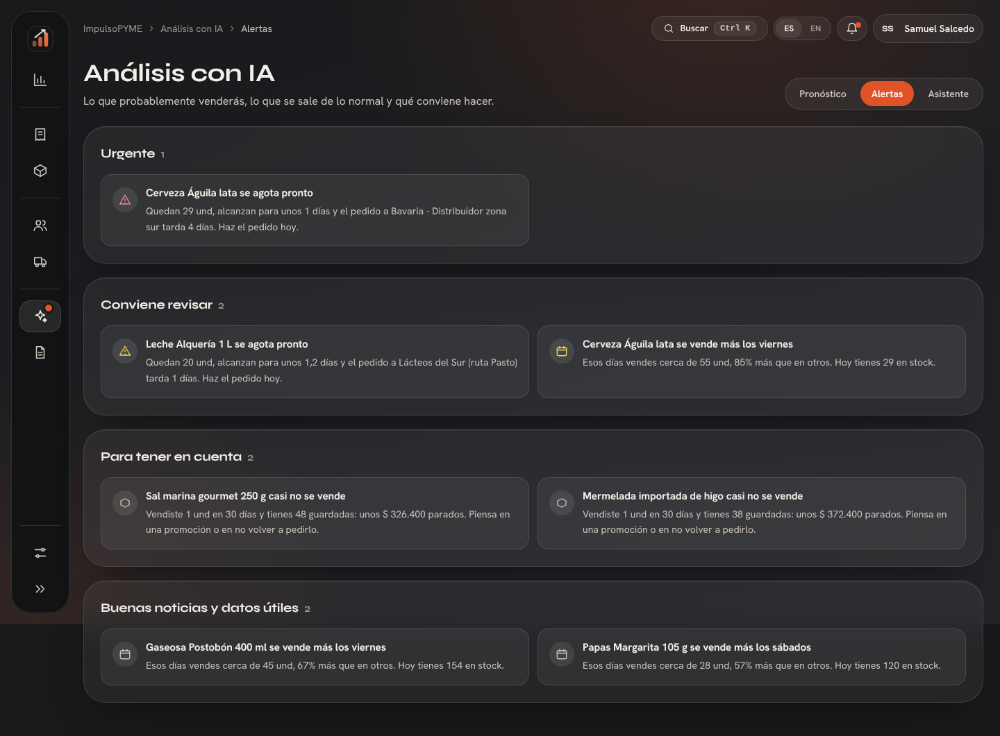
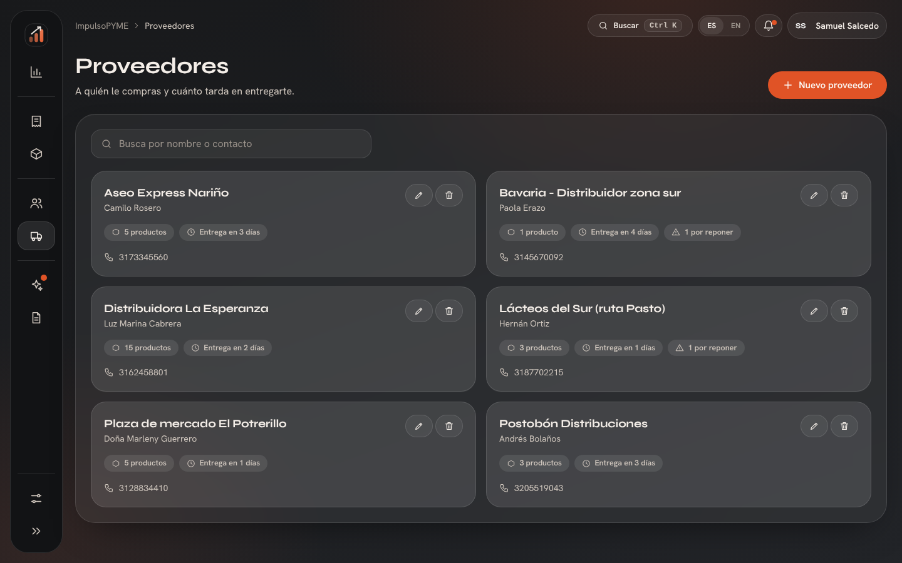
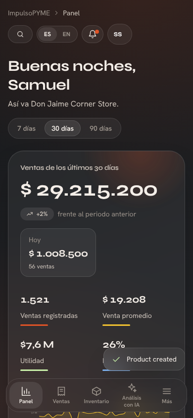

# ImpulsoPYME


Sistema de gestión y análisis para pequeños negocios colombianos: ventas, inventario, productos, clientes y proveedores, con un panel de control y **IA** que pronostica ventas, detecta anomalías y recomienda qué hacer. Apoya los **ODS 8** (trabajo decente y crecimiento económico) y **9** (industria, innovación e infraestructura).

> Proyecto de *Diseño de Interfaces de Software* · Universidad Cooperativa de Colombia, Pasto · Samuel Salcedo.

## Qué hace

| Sección | Para qué sirve |
| --- | --- |
| Panel | Ventas del periodo, utilidad, margen, productos estrella, categorías y alertas de hoy |
| Ventas | Punto de venta táctil, historial y anulación (devuelve el inventario) |
| Inventario | Productos, categorías, existencias mínimas y ajustes por entrada, merma o conteo |
| Clientes / Proveedores | Historial de compras, tiempos de entrega y productos surtidos |
| Análisis con IA | Pronóstico con rango probable, días anómalos con su causa, qué pedir y asistente con Vertex AI |
| Reportes | CSV de ventas, productos e inventario (abren en Excel) |
| Ajustes | Cuenta, negocio, idioma (ES/EN) y conexión con Google Cloud |

El tipo de negocio se elige al registrarse (tienda de barrio, restaurante, papelería o ferretería) y carga un catálogo de ejemplo de 4 meses de ventas.

## Instalar la app (usuarios)

Descarga el instalador desde la página **Releases** del repositorio:

* **Windows:** `ImpulsoPYME-…-win-x64.exe` (instalador; si Windows avisa «protegió su equipo», pulsa *Más información → Ejecutar de todas formas*, porque la app no está firmada).
* **Mac:** `ImpulsoPYME-…-mac-arm64.dmg` (chips M1 o posteriores) o `…-mac-x64.dmg` (Intel). Arrastra la app a *Aplicaciones* y la primera vez ábrela con clic derecho → *Abrir*.

Tus datos se guardan solo en tu equipo.

## Ejecutar desde el código (desarrollo)

Necesitas **Node.js 22 LTS** y Git.

```bash
git clone https://github.com/SamuelSalcedo22/impulsopyme.git
cd impulsopyme
npm install
npm run seed      # opcional: crea el usuario demo (demo / demo12345) con datos de ejemplo
npm start         # abre http://127.0.0.1:3000
```

Como app de escritorio:

```bash
npm run electron
```

Pruebas: `npm test` (análisis estadístico, API, tokens de diseño y paridad ES/EN).

## Generar los instaladores

Lo hace GitHub Actions: sube una etiqueta y se construyen el `.exe` y los `.dmg`.

```bash
git tag v1.0.0
git push origin v1.0.0
```

En la pestaña **Actions** verás el progreso; al terminar, los archivos aparecen en **Releases**. (Un `.dmg` solo puede construirse en macOS, por eso se usa GitHub Actions.)

## Conectar Vertex AI (opcional)

Sin esto la app funciona completa con el pronóstico y las alertas locales. Con Vertex AI se activa el **asistente** que redacta el resumen de la semana.

1. En Google Cloud crea o elige un proyecto y habilita la **Vertex AI API**.
2. *IAM y administración → Cuentas de servicio → Crear*. Asígnale el rol **Usuario de Vertex AI**.
3. En la cuenta: *Claves → Agregar clave → JSON*. Se descarga un archivo.
4. En la app: **Ajustes → Inteligencia artificial → Conectar** y selecciona ese archivo. (O copia el archivo a `credentials/vertex-key.json`.)

La llave solo vive en el servidor local con permisos restringidos; nunca llega al navegador. A Google solo viajan cifras agregadas (sin nombres de clientes).

## Arquitectura

```
public/             Interfaz (JavaScript sin framework, módulos ES)
  js/atoms          Botón, campo, chip, ícono, logo…
  js/molecules      Campo con etiqueta, pestañas, migas de pan, tarjeta de alerta…
  js/organisms      Barra lateral, barra superior, búsqueda Ctrl+K, gráficos SVG, modal
  js/templates      appShell, authLayout, pageHeader
  js/pages          Una por sección
  js/core           Router por hash, i18n, API, estado
  i18n/             es.json · en.json
design/tokens.json Tokens en 3 niveles (global → semántico → componente)
server/             Express + SQLite (node:sqlite integrado, sin compilar nada), análisis y Vertex AI
electron/           Ventana de escritorio
tests/              node --test
```

Decisiones de diseño y contenido en [`docs/`](docs): [voz y tono](docs/voz-y-tono.md) y [arquitectura de información](docs/arquitectura-de-informacion.md).

## Licencia

MIT

## Capturas

| Panel | Pronóstico |
| --- | --- |
|  |  |

| Ventas | Inventario |
| --- | --- |
|  |  |

| Alertas | Proveedores | Móvil |
| --- | --- | --- |
|  |  |  |
